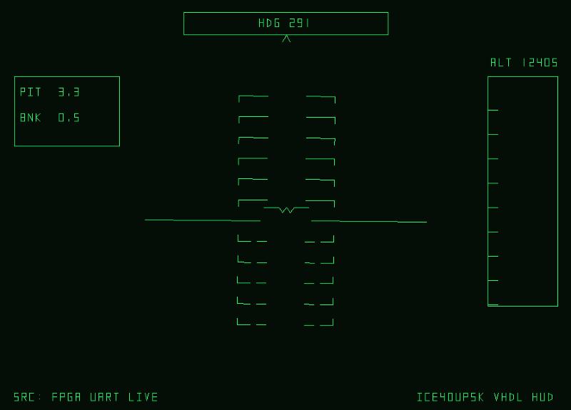
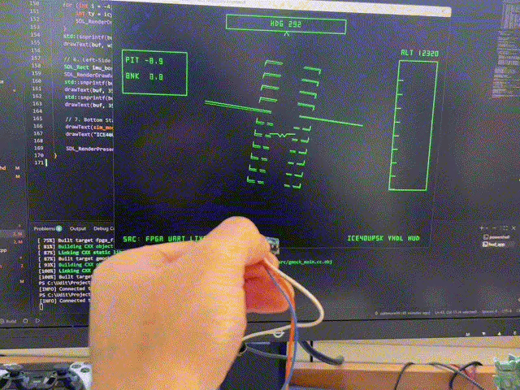
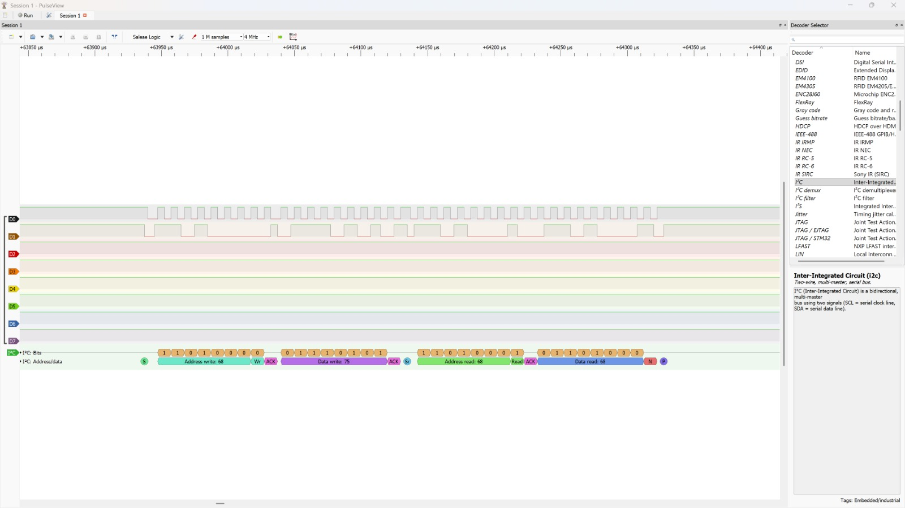

# ICEHUD

**An FPGA-driven aviation HUD, built around an iCE40UP5K and an MPU6050.**

ICEHUD reads accelerometer data over I²C, sends it from the FPGA over UART, and renders a green-on-black attitude display on a Windows PC. The FPGA logic is written in VHDL; the desktop application is C++ and SDL2.

<p align="center">
  
</p>

The display draws an artificial horizon and pitch ladder from the sensor's pitch and bank angles. The visual style is inspired by compact avionics displays, while the hardware path is deliberately simple enough to follow and rebuild.

> This is a bench demonstration, not a flight instrument. The current firmware uses the MPU6050 accelerometer only; it does not fuse gyroscope data. Acceleration other than gravity can therefore affect the displayed attitude.

## Demo

<p align="center">
  
</p>

The live display uses sensor pitch and roll. Heading and altitude are animated demo values in the current desktop app; they are not read from the MPU6050 or sent by the FPGA.

### I²C capture

<p align="center">
  
</p>

This PulseView trace is an identity-register check: the I²C master addresses the MPU6050 at `0x68`, writes register `0x75` (`WHO_AM_I`), and reads back `0x68`. The live FPGA design wakes the sensor and reads the six accelerometer bytes beginning at register `0x3B`.

## How it works


At startup, the FPGA writes `0x00` to the MPU6050 power-management register `0x6B` to wake it. It then reads registers `0x3B` through `0x40` in one burst. A sample is sent only when the I²C address and register phases are acknowledged. If the sensor does not acknowledge, the FPGA reports the bus error and retries its wake-up sequence.

The desktop parser validates each UART frame and calculates pitch and bank from the three signed accelerometer axes. A one-pole exponential smoother (`α = 0.18`) reduces visible jitter; roll uses the shortest angular path when crossing `-180°`/`+180°`.

## Hardware

### Parts

| Part | Use |
| --- | --- |
| MuseLab iCESugar v1.5, iCE40UP5K-SG48 | FPGA board, iCELink programmer, and USB CDC serial bridge |
| MPU6050 breakout board | Three-axis accelerometer input |
| USB cable | Board power, programming, and serial connection to the PC |
| Jumper wires or a PMOD adapter | Connect the sensor to PMOD3 |

### Wiring

Connect the MPU6050 breakout to PMOD3. The PMOD signal numbers below match the board pin assignment used in [`rtl/icesugar.pcf`](rtl/icesugar.pcf).

| MPU6050 breakout | iCESugar v1.5 PMOD3 | FPGA pin |
| --- | --- | ---: |
| SDA | Pin 1 | 34 |
| SCL | Pin 2 | 31 |
| VCC | 3.3 V | — |
| GND | GND | — |

Use 3.3 V logic on SDA and SCL. The PCF enables the iCE40's 6.8 kΩ pull-ups on both I²C lines. The firmware expects the sensor's AD0 pin to select address `0x68` (the usual MPU6050 default); a sensor strapped to `0x69` needs a corresponding RTL change. Check the board silkscreen and the [iCESugar hardware documentation](https://github.com/wuxx/icesugar/blob/master/README_en.md) before connecting power.

The UART output is routed to FPGA pin 6, which is connected to the board's iCELink USB CDC bridge. No separate USB-to-UART adapter is needed.

### On-board status LEDs

The RGB LEDs are active-low and provide a quick view of the FPGA state:

| LED | Meaning |
| --- | --- |
| Green | The I²C transaction completed with acknowledgments |
| Red | An I²C address or register phase was not acknowledged |
| Blue | The UART transmitter is sending a frame |

## Recreate the project on Windows

The steps below keep the desktop compiler and FPGA tools in their intended environments. Run package installation in the named MSYS2 terminal; run the CMake commands from **PowerShell in the repository root**.

### 1. Install the desktop dependencies

Install [CMake for Windows](https://cmake.org/download/) and [MSYS2](https://www.msys2.org/). Open the **MSYS2 MINGW64** terminal and install the MinGW-w64 compiler, SDL2, and make:

```sh
pacman -Syu
pacman -S --needed mingw-w64-x86_64-toolchain mingw-w64-x86_64-SDL2 mingw-w64-x86_64-make
```

If MSYS2 asks you to close the terminal during the system update, reopen **MINGW64** and run the package install command again.

### 2. Configure and build the HUD app

Open PowerShell, change to the project root, and point CMake at the matching MINGW64 compiler and SDL2 package:

```powershell
$env:PATH = "C:\msys64\mingw64\bin;$env:PATH"

cmake -S . -B build -G "MinGW Makefiles" `
  -DCMAKE_CXX_COMPILER=C:/msys64/mingw64/bin/g++.exe `
  -DSDL2_DIR=C:/msys64/mingw64/lib/cmake/SDL2

cmake --build build --target hud_app
```

The project uses CMake's `FetchContent` to obtain GoogleTest 1.14.0 during the first configure, so that first configure needs internet access. SDL2's runtime DLL is in the MINGW64 `bin` directory; keeping that directory on `PATH` also lets Windows find it when the app starts.

### 3. Run the app

For a desktop-only demo using synthetic sensor data:

```powershell
.\build\hud_app.exe --sim
```

For live FPGA telemetry, find the iCELink serial port in Windows Device Manager and pass its COM port:

```powershell
.\build\hud_app.exe COM5
```

Replace `COM5` with the port shown on your machine. The serial link uses **115200 baud, 8 data bits, no parity, 1 stop bit (8N1)**. Close other serial monitor programs before starting the HUD because the app opens the port exclusively. Press **Esc** to close the HUD.

If the port cannot be opened, the app prints a warning and falls back to simulation. Check the PowerShell output for either `Connected to FPGA UART` or `Could not open` before diagnosing the sensor.

## Build and program the FPGA

The HDL build uses GHDL, Yosys, nextpnr-ice40, and icepack. This project was built on Windows with GHDL from MSYS2 UCRT64 and the synthesis/place-and-route tools from [OSS CAD Suite](https://github.com/YosysHQ/oss-cad-suite-build/releases). MINGW64 supplies `mingw32-make`. Keep the desktop app on the MINGW64 compiler and SDL2 package; do not use UCRT64 headers or libraries to build that app.

Install the GHDL LLVM backend from the **MSYS2 UCRT64** terminal:

```sh
pacman -S --needed mingw-w64-ucrt-x86_64-ghdl-llvm
```

The LLVM and mcode GHDL packages conflict. Keep the LLVM package if MSYS2 says removing it would break a Yosys dependency; do not approve that removal to install the mcode variant.

From PowerShell in the project root, add the tool directories to `PATH` before configuring CMake. Adjust the OSS CAD Suite path if it is installed elsewhere:

```powershell
$env:PATH = "C:\oss-cad-suite\bin;C:\oss-cad-suite\lib;C:\msys64\ucrt64\bin;C:\msys64\mingw64\bin;$env:PATH"

ghdl --version
yosys -V
nextpnr-ice40 --version

cmake -S . -B build -G "MinGW Makefiles" `
  -DCMAKE_CXX_COMPILER=C:/msys64/mingw64/bin/g++.exe `
  -DSDL2_DIR=C:/msys64/mingw64/lib/cmake/SDL2

cmake --build build --target fpga_firmware
```

The explicit configure step matters: CMake checks which FPGA tools are available when it configures the build and only creates the `fpga_firmware` target when it finds the full toolchain. The generated bitstream is `rtl/hud_top.bin`.

To program the board, connect it over USB and copy `rtl/hud_top.bin` to the **iCELink** drive that appears in Windows. Wait for programming to finish before launching the desktop app. The iCESugar's onboard iCELink supports drag-and-drop bitstream programming and provides the USB CDC serial port used by the HUD.

## Telemetry format

The FPGA sends one 9-byte UART frame per valid accelerometer sample:

| Byte offset | Contents |
| ---: | --- |
| 0 | Sync byte `0xAA` |
| 1 | Sync byte `0x55` |
| 2–3 | X acceleration, signed 16-bit, big-endian |
| 4–5 | Y acceleration, signed 16-bit, big-endian |
| 6–7 | Z acceleration, signed 16-bit, big-endian |
| 8 | XOR of bytes 2–7 |

The MPU6050's default accelerometer range is used. Pitch and bank are calculated as:

```text
pitch = atan2(-ax, sqrt(ay² + az²))
bank  = atan2(ay, az)
```

The parser rejects frames with a bad sync header, checksum, or all-zero acceleration payload. The RTL reads accelerometer data only; gyroscope and magnetometer measurements are not part of this protocol.

## Build targets and tests

| Target | Result |
| --- | --- |
| `hud_app` | Desktop SDL2 application |
| `hud_tests` | C++ telemetry parser tests |
| `fpga_firmware` | `rtl/hud_top.bin`, when the FPGA toolchain was found at configure time |

Build the parser test executable and run the registered tests with:

```powershell
cmake --build build --target hud_tests
ctest --test-dir build --output-on-failure
```

The tests cover level attitude, 45-degree pitch and bank, invalid sync, and a corrupted checksum. The test target is separate from the app and FPGA build targets.

## Troubleshooting

| Symptom | Check |
| --- | --- |
| CMake cannot find SDL2 | Install `mingw-w64-x86_64-SDL2` from the MINGW64 terminal and pass the `SDL2_DIR` shown above. |
| `stdlib.h` missing or MinGW headers conflict | Use the MINGW64 compiler with MINGW64 SDL2. Do not mix MINGW64 and UCRT64 include or library paths for the desktop build. |
| `fpga_firmware` is an unknown target | Add the FPGA tools to `PATH`, then run the CMake configure command again before building the target. |
| FPGA build reports a command is not found | Check that `ghdl`, `yosys`, `nextpnr-ice40`, `icepack`, and `mingw32-make` resolve in the PowerShell session. Keep `C:\oss-cad-suite\lib` on `PATH` so the OSS CAD Suite DLLs can load. |
| HUD starts in simulation instead of live mode | Check the COM port in Device Manager, close other serial programs, and confirm the terminal printed `Connected to FPGA UART`. A port-open failure intentionally falls back to simulation. |
| Red status LED stays on or there is no live data | Check SDA/SCL wiring, 3.3 V logic, common ground, the sensor's `0x68` address, and that the programmed bitstream matches this project's PMOD3 pin assignments. |
| Rebuilding fails with `Permission denied` on `hud_app.exe` | Close the running HUD window first; Windows locks an executable while it is open. |

## Repository layout

```text
assets/       Demo GIFs and the PulseView capture
include/      HUD and telemetry interfaces
src/          SDL2 renderer, serial input, and frame parser
rtl/          Clock divider, MPU6050 I²C master, UART transmitter, and PCF
tests/        Telemetry parser tests
CMakeLists.txt
```

The FPGA source files and pin constraints live in [`rtl/`](rtl/). The main connection and protocol details are documented above so the project can be rebuilt without relying on a precompiled bitstream.
